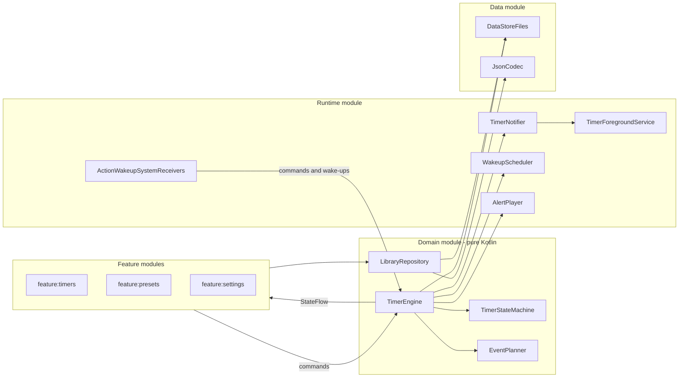
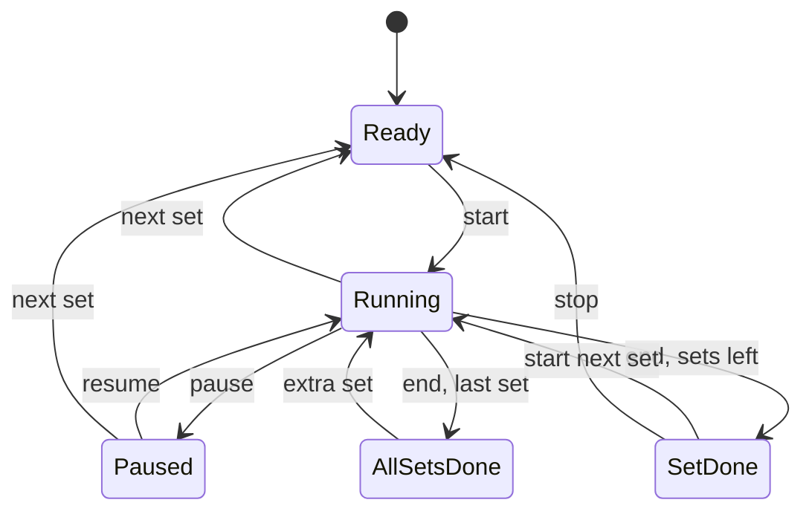
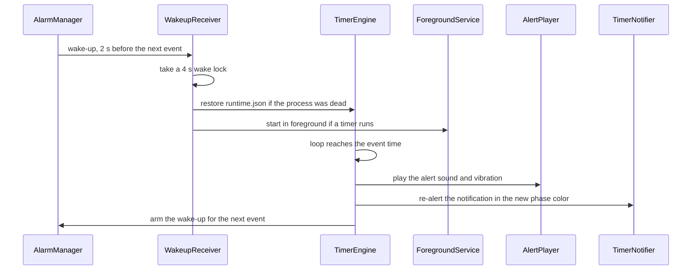

# NotificationTimer 2.0 plan

NotificationTimer 2.0 is a Kotlin rewrite that runs several timers at once. Each timer has its own alerts and its own notification controls. This plan turns [REFACTOR.md](REFACTOR.md) into a functional spec, technical decisions and phases with exit criteria.

It's written for AI implementation. Every session starts from this file and `AGENT.md`, and ticks the checkboxes in section 13 as work lands.

## 1. REFACTOR.md coverage

Features:
- Keep big numbers, keep screen on, notification controls and personalization: all kept (sections 4.2 to 4.6).
- N simultaneous timers with swipe, and N notifications: one tab and one notification per timer (sections 4.2, 7 and 9).
- M extra notifications per timer, each with a name, time, ringtone and color, chosen when a preset is created: alerts (sections 4.5 and 7).
- Settings that work and export like 1.x: sections 4.6 and 4.7.
- The same custom notification layout: ported unchanged (section 9).
- Top bar presets that show which timers run by color and jump to their tab in one tap: section 4.2.
- A better help page: no tutorial. An empty state and a short "How it works" page replace it (section 4.2).

Technical:
- Kotlin, a complete rewrite, a new project: sections 5 and 13 (Phase 0).
- A generic, scalable architecture where the UI owns nothing: section 6.
- Unit and integration tests, something like Playwright: UI Automator for notifications and Maestro for end-to-end flows (section 12).
- Timer service recovery with alarms, N×M timers, IDs: the 1.x wake-up recipe, kept and generalized (section 8), plus an ID scheme (section 7).
- A better numpad or a round picker: a Compose numpad now, a circular dial later (sections 4.4 and 13).
- Fully AI implementation: section 15.

Scope:
- No 1.x migration: dropped (section 2).
- Min SDK of Android 15, 16 or 17: minSdk 35 (section 5).
- Functional first, Material 3 Expressive later: the redesign only touches UI modules (sections 6 and 13).

## 2. What 1.x does today

Version 1.5.20 is a single-module Java app (minSdk 23) built around one timer.

Keep (users rely on it):
- The custom notification: 3 buttons, a progress bar and a background colored by phase, usable on the lock screen. Layout: [mobile/src/main/res/layout-v29/notification.xml](mobile/src/main/res/layout-v29/notification.xml), plus its black, white and red text variants.
- The button set for each state, from `InteractiveNotification.updateButtonsLayout()` (section 9).
- The background recipe: a foreground service, an exact wake-up alarm 2 seconds before each event, and a short wake lock. This is why 1.x works well in the background (section 8).
- Big numbers that fill any window size, using the Recursive fonts in [mobile/src/main/assets/fonts](mobile/src/main/assets/fonts). Under one minute, only the seconds are shown.
- Keep screen on, the sets counter, the presets strip with its time or name display, launcher shortcuts for the first 4 presets, and split screen.
- Settings for the ±time steps, the notification step-time button, confirmations, theme and colors, plus backup and restore. Strings exist in English, French and Spanish.

Rewrite (blocks N timers or is fragile):
- Timer state is copied and synced by hand across three classes:
  - [mobile/src/main/java/com/notification/timer/TimerService.java](mobile/src/main/java/com/notification/timer/TimerService.java)
  - [mobile/src/main/java/com/notification/timer/MainActivity.java](mobile/src/main/java/com/notification/timer/MainActivity.java) (2,000 lines)
  - [mobile/src/main/java/com/notification/timer/InteractiveNotification.java](mobile/src/main/java/com/notification/timer/InteractiveNotification.java)
- The notification ID is fixed at 52, every PendingIntent uses request code 0, and there is a single alarm. Two timers can't be told apart.
- Countdown state is saved only every 5 seconds. Recovery estimates the remaining time from a saved wall-clock end time.
- Commands are implicit broadcasts to a receiver registered with `RECEIVER_EXPORTED`, so any installed app can start or clear a timer.
- Sound and vibration live on notification channels. Each settings change deletes the channel and recreates it under a new ID.
- The notification is re-posted every second. Android drops updates above about 5 per second per app, so this breaks once several timers run.
- Settings use the deprecated `android.preference` API. Backup writes the raw `SharedPreferences` map with Java serialization.
- The `betterpickers` sources are vendored, there are no tests, and there is no Gradle wrapper or settings file.

Drop:
- LED color and flash rate settings, since current devices have no notification LED.
- The image-based help overlay.
- The in-app done dialogs. The timer page shows the same choices instead (section 4.3).
- Migration of 1.x settings and presets, which is out of scope.

## 3. Glossary

- Preset: a saved template with a duration, a number of sets, alerts, colors and a name.
- Timer: a live instance on its own tab, created from a preset or the numpad. It has its own state, notification and events, and lives until it is cleared.
- Set: one run of the countdown. A timer repeats it a fixed number of times or indefinitely. 1.x called these "timer number" and "limit indicator".
- Alert: a point before the end, such as 0:15 left. It plays a sound, vibrates, re-alerts the notification and switches the phase color. The done alert is the one at 0:00.
- Phase: the stretch between two alerts. Each phase has a color, and the running color applies before the first alert.
- Event: an alert or the end of a set, as scheduled by the engine.

## 4. Product spec

### 4.1 Scope

2.0 is functional first. The visual design comes later with Material 3 Expressive.

In 2.0:
- Everything kept from 1.x in section 2.
- Up to 5 concurrent live timers, one tab each, swiped left or right. Each has its own notification.
- Presets as templates. Several timers can run from the same preset ("Pasta" and "Pasta 2").
- Up to 5 alerts per preset, plus the done alert. Each alert has a name, a time before the end, a sound, vibration and a color. The limit of 5 is a constant that's easy to raise.
- A preset editor that walks through those choices.
- Settings, plus export and import as JSON.
- Tapping a notification opens the app on that timer's tab.

Later, not in 2.0:
- The Material 3 Expressive redesign.
- A circular dial picker next to the numpad.
- The Android 16 Live Updates notification style, which can't use custom layouts or colorized notifications.
- Widgets, a Quick Settings tile, and an option to play alerts on the alarm volume.

### 4.2 Main screen

- Top bar: the app title, a settings button, and a menu with keep screen on, How it works, rate the app and send feedback.
- Presets strip, under the top bar and scrolling horizontally:
  - "+" comes first and opens the "+" page described below.
  - Timers created from the numpad come right after "+", as temporary chips with a save action, like the 1.x "+" card. They disappear when cleared.
  - Presets follow in the user's order. Each chip shows its time or its name.
  - A chip with live timers takes the phase color of its most urgent timer. Priority goes to the running timer closest to its end, then a done timer, then a paused one.
  - A chip shows a count when more than one of its timers is live, and the chip of the visible tab is outlined.
  - Tap: jump to the preset's live timer, cycling through them if there are several. If none is live, create a ready timer from the preset and jump to it.
  - Long press: a menu with start another timer from this preset, edit, duplicate, show name or time, move left or right, and delete.
  - In short windows the strip folds away, and a top bar button shows it again (the 1.x compact modes).
- Timer pager: one page per live timer in creation order, with a page indicator. New timers are inserted before the "+" page, and clearing a timer shows its neighbor.
- "+" page, always last:
  - the numpad (section 4.4), to create a timer;
  - the preset list, to create a timer from a preset;
  - a "New preset" button that opens the editor.
- Empty state: with no live timers, the "+" page adds two lines explaining that timers are controlled from their notification, including on the lock screen.
- How it works: a short text page, reachable from the menu and from settings. It covers presets, alerts, sets and the notification buttons.

### 4.3 Timer page

- Background: a progress fill in the phase color that grows from the top as time elapses, as in 1.x. The text color follows the fill's luminance.
- Time: H:MM:SS from one hour, M:SS from one minute, then seconds only. Hours and minutes are bold and seconds regular, in the Recursive monospace fonts, sized to fill the available space.
- Info line: the set counter ("2", or "2/5" with a limit) and the timer name, which can be edited in place. The display settings can hide either one.
- Controls:
  - Full height: one row with the ±X buttons around keep screen on, and one row with reset or clear, start/pause/resume, and next set.
  - Short windows: a single row, with the ±X buttons on the sides of reset or clear, start/pause/resume, and next set.
  - Very short windows: the time and the main row only.
  - Buttons that don't apply in the current state are disabled. The domain decides which apply (section 7).
- Done state, replacing the 1.x dialogs: the page shows the done color, the done alert name ("Time out!" by default) and the time since the end.
  - Set done: start the next set, or stop and keep it ready.
  - All sets done: extra set, reset or clear.
- Confirmation before clearing or resetting a running or paused timer, with "stop asking", as in 1.x.
- Save as preset, for timers created from the numpad, opens the preset editor prefilled.

### 4.4 Numpad

- Digits are typed from the right into H:MM:SS, up to 99:59:59, like the Clock app. Backspace deletes a digit, and a long press on it clears the entry.
- An optional sets stepper goes from 1 to 99, or infinite, which is the default.
- Confirm creates a ready timer with the default alerts from settings and jumps to its tab.

### 4.5 Preset editor

Creating a preset is a wizard with one screen per step and Back and Next buttons. Every step has defaults, so Save is available from step 2 on.

1. Duration (on the numpad) and sets.
2. Number of alerts before the end, from 0 to 5.
3. One screen per alert: name, time before the end, color, sound and vibration.
   - The first alert defaults to the settings template: "Get ready", 0:15, orange.
   - Later alerts default to "Alert 2", "Alert 3" and so on.
4. Done alert: name, color, sound and vibration.
5. Running color, preset name, and whether the chip shows the name or the time.
6. Summary: a timeline of each phase's color over the duration, then Save.

Rules:
- Alert times must be greater than 0, shorter than the duration, and all different. Alerts are kept in firing order.
- Sounds come from the system ringtone picker. The default is the notification sound, and silent is allowed.
- Colors come from the 1.x palette of 18 colors.
- Editing an existing preset shows the same fields on one scrollable screen instead of the wizard. Live timers keep their own copy and aren't affected.

### 4.6 Settings

Defaults come from 1.x wherever the setting exists there.

Timer controls:
- Time added by +X: 20 seconds. The choices are 10, 15, 20, 30, 45 or 60.
- Time removed by −X: 20 seconds, with the same choices.
- Notification step-time button: −20 seconds, from ±10 to ±60.

Defaults for new timers and presets:
- Running color: indigo.
- Default alert: off. When on, it fires 0:15 before the end, in orange, with the notification sound and vibration. This is the 1.x "extra notification".
- Done alert: green, with the notification sound and vibration.
- Sets: infinite.

Display:
- Show the set counter: on.
- Show the timer name: on.
- Colored notifications: on. When off, alerts use the 1.x red text variant.
- Theme: system, light or dark.

Behavior:
- Ask before clearing or resetting a running timer: on.
- Keep screen on while the app is open: off. The menu toggle also changes it.

Notifications:
- Permission status, with a link to the system notification settings.

Backup:
- Export and import (section 4.7).

About:
- How it works, rate the app, send feedback, and the version.

1.x settings dropped:
- LED light and flash rate.
- Background theme, now covered by the theme and the phase color.
- Timer number reset and limit indicator reinitialization. Each timer now has its own counter, and reset is always available.
- The limit indicator picker, since the numpad always offers sets.
- The timer selection alert, since picking a preset no longer replaces a running timer.
- The channel sound and vibration shortcuts, since sounds are now set per alert in the app.

### 4.7 Export and import

- Export writes `notification_timer_YYYYMMDD.json` through the Storage Access Framework. The file holds the settings and the presets with their alerts, and no live timers.
- Import reads a file and first shows what it contains, for example "12 presets and settings". After confirmation it replaces everything.
- Import ignores unknown fields, and refuses a file with a newer `schemaVersion`, with a message.

Format sketch (`"sets": null` means infinite):

```json
{
  "schemaVersion": 1,
  "appVersion": "2.0.0",
  "exportedAt": "2026-10-27T18:00:00Z",
  "settings": { "timeIncrementSec": 20, "timeDecrementSec": 20, "stepTimeSec": -20, "theme": "system" },
  "presets": [
    {
      "id": "6f1c2a9e-5b7d-4c3e-9a1f-2d8e4b6c0a11",
      "name": "Plank",
      "durationSec": 60,
      "sets": 3,
      "runningColor": "#3F51B5",
      "chipShows": "time",
      "alerts": [
        { "name": "Get ready", "beforeEndSec": 15, "color": "#FF9800", "sound": "content://settings/system/notification_sound", "vibrate": true }
      ],
      "done": { "name": "Time out!", "color": "#4CAF50", "sound": "content://settings/system/notification_sound", "vibrate": true }
    }
  ]
}
```

## 5. Key decisions

- Branches: create `release/1.5` from `main` and tag `v1.5.20` for 1.x fixes. 2.0 is developed on `main`, in this folder.
- App identity: keep `com.notification.timer`, so 2.0 ships as a Play Store update.
  - versionName 2.0.0 and versionCode 20000, following the 1.x scheme where 10520 means 1.5.20.
  - Debug builds add a `.debug` suffix so they install next to 1.x.
- SDK levels: minSdk 35 (Android 15), and target and compile SDK 37, as in 1.x. Nothing the app needs is newer than API 35, and 35 reaches more devices than 36.
- Stack:
  - App: Kotlin, Jetpack Compose and Material 3 with the baseline theme, plus Hilt, Coroutines and Flow, kotlinx.serialization and DataStore.
  - Build: Gradle Kotlin DSL with a version catalog and convention plugins, on the latest stable versions when the project is scaffolded.
- Storage: typed DataStore files in JSON instead of Room. The data is small and document-shaped, and export can reuse the same models.
  - `library.json` holds presets and settings. It's included in Auto Backup and in exports.
  - `runtime.json` holds the live timers. It lives in `noBackupFilesDir` and is never exported.
- Time: a timer stores timestamps (`elapsedRealtime`, the wall clock and the boot count), never tick counts. Remaining time is always computed from them.
- Timing: keep the 1.x recipe (foreground service, an exact wake-up alarm 2 seconds before each event, and a short wake lock) and generalize it to N timers with M alerts (section 8).
- Sound: the app plays alert sounds and vibration itself, as the AOSP Clock app does. Each alert plays once, as in 1.x, and other audio is ducked while it plays.
  - Audio uses the notification usage, so the notification volume and Do Not Disturb apply as they did with 1.x channels.
  - Channels stay fixed and silent, so per-alert sounds don't need one channel per sound.
- Notification rendering: the 1.x layout is kept, but its time text becomes a RemoteViews `Chronometer` counting down, so the system draws the seconds. The app re-posts only on state changes, on alerts and for throttled progress updates.
- Foreground service: one `specialUse` foreground service runs while at least one timer is running and the app is in the background.
  - Notifications stay hidden while the app is open, as in 1.x.
  - If Android refuses the foreground start, plain notifications are posted, and the wake-up alarms still keep events on time.
- Input: a Compose numpad replaces betterpickers.

## 6. Architecture

The UI owns nothing: it renders `StateFlow`s and sends commands. All timer rules live in `:core:domain`, which is pure Kotlin and tested on the JVM. Android side effects sit behind interfaces (ports) that `:core:runtime` and `:core:data` implement.

Modules:
- `:app`: the Application, MainActivity, navigation and Hilt wiring.
- `:feature:timers`: the presets strip, the timer pager, the timer page and the "+" page.
- `:feature:presets`: the numpad and the preset editor.
- `:feature:settings`: settings, export and import, and How it works.
- `:core:ui`: the theme, Recursive fonts, auto-fitting timer text and shared components. The Material 3 Expressive redesign only touches this module and the feature modules.
- `:core:domain`: the models, the state machine, the event planner, `TimerEngine`, and these ports:
  - `TimerStore` and `LibraryRepository`;
  - `WakeupScheduler`, which arms a wake-up or keeps the CPU awake until a given time;
  - `AlertPlayer` and `TimerNotifier`;
  - `TimeSource`.
- `:core:data`: the DataStore stores, the JSON codec, and export and import.
- `:core:runtime`: the foreground service, the notification renderer with the 1.x XML, the wake-up scheduler, the alert player, the broadcast receivers and app-visibility tracking.
- `:core:testing`: a fake clock, in-memory stores, fake adapters and test rules.

Dependency rules:
- Feature modules depend only on `:core:domain` and `:core:ui`.
- `:core:domain` has no Android dependency.
- Only `:app` sees every module.



Invariants for every change:
1. Only the domain state machine changes timer state. The UI, receivers and services only send commands.
2. Timer math uses only `TimeSource`, which is backed by `SystemClock.elapsedRealtime()`. Never use `System.nanoTime()`, Kotlin's `TimeSource.Monotonic` or `uptimeMillis` for it, because they stop while the phone sleeps.
3. Never count ticks. Store timestamps and compute the remaining time from them.
4. Save on every transition, not on ticks. The state after a process kill must equal the state before it.
5. The engine handles commands, wake-ups and events one at a time.
6. Every Android ID derives from a `TimerId` or a `PresetId` (section 7).
7. Only the launcher activity is exported. There are no implicit broadcasts, and every PendingIntent is explicit and immutable.
8. Notification posts stay within the budget in section 9.
9. A composable that branches on timer state for anything beyond rendering means a rule has leaked out of the domain module.

## 7. Domain model and rules

Model:
- `Preset`:
  - a `PresetId`, which is a UUID that stays stable across export and import;
  - a name, a duration, and a number of sets (or infinite);
  - a running color, a list of `Alert`s and a done alert;
  - whether its chip shows the name or the time.
- `Alert`: a name, a time before the end, a color, a sound and a vibrate flag.
- `Timer`:
  - a `TimerId`, plus the source `PresetId`, which is null for numpad timers;
  - a snapshot of the preset's config, so editing a preset never changes a live timer;
  - a label, the current set and the state.
- `TimerState` is one of `Ready`, `Running(endsAt)`, `Paused(remaining)`, `SetDone(finishedAt)` or `AllSetsDone(finishedAt)`. The running and paused states also record which alerts already fired in the current set.

States (same as 1.x):



From any state, reset goes back to `Ready` at set 1, and clear removes the timer.

Commands (each carries its `TimerId`, except create):
- Create, from a preset or from numpad values: a new `Ready` timer at set 1.
- Start, pause and resume, as in the diagram.
- Adjust the time by ±X, while running or paused. Reaching 0 ends the set at once, and the maximum is 99:59:59.
- Step time, from the notification button: adjusts the time by the step-time setting while running. As in 1.x, it's disabled when it would go above 99:59:59.
- Next set: from running or paused, go to `Ready` for the next set.
- Start next set or stop: from `SetDone`, start the next set or keep it ready.
- Extra set: from `AllSetsDone`, run one more set beyond the limit.
- Reset, clear and rename.

Rules:
- Alerts:
  - An alert fires once per set, when the remaining time crosses its time while running.
  - Adjusting the time across an alert skips it silently, as in 1.x. Adding time back above it re-arms it.
  - An alert whose time is equal to or longer than the timer's duration is ignored for that timer, as in 1.x. This covers numpad timers using the default alert.
- The phase color is a pure function of the state and the remaining time:
  - `Ready`: neutral and not colorized, as in 1.x.
  - Running or paused: the color of the last alert crossed, or the running color before the first one.
  - Done states: the done color.
- Sets: the end of a set goes to `SetDone` while sets are left, and to `AllSetsDone` after the last one. With infinite sets, `AllSetsDone` never happens.
- `actionsFor(timer)` returns the available actions, and both the notification and the timer page render from it.
- Labels come from the preset name. Duplicates get " 2", " 3" and so on.
- Limits are constants: 5 alerts per preset and 99:59:59 per duration. The model enforces a soft limit of 5 concurrent live timers to prevent OS notification rate limiting. Tests use 5.

ID scheme:
- `TimerId` comes from a persisted counter that starts at 1000 and never reuses a value.
- The notification ID is the `TimerId`. IDs below 1000 are reserved.
- Action PendingIntents are explicit, target a non-exported receiver, use `FLAG_IMMUTABLE`, and carry `ntimer://timer/{id}/{action}`.
  - The URI keeps each timer and action distinct, because extras don't count toward PendingIntent identity.
  - Swiping a notification away sends the clear action.
- A notification tap opens the activity with `ntimer://open/{id}`. Launcher shortcuts use `ntimer://preset/{presetId}`. These URIs only identify explicit intents and are never exported as deep links.
- One wake-up alarm PendingIntent (`ntimer://wakeup`) serves all timers (section 8).
- Commands for unknown IDs, from stale notifications or shortcuts, are ignored.

## 8. Timing engine

This section answers REFACTOR.md's question about recovery with alarms. The 1.x approach is still the right one, and it scales to N timers with M alerts once IDs and a shared scheduler exist.

How 1.x does it:
- `TimerService` runs the countdown in the app with 1-second `CountDownPauseTimer` ticks. Each tick recomputes the remaining time from `SystemClock.elapsedRealtime()`.
- `setupAlarmManager()` sets an exact `RTC_WAKEUP` alarm 2 seconds (`WAKELOCK_TIME_APPROX`) before the next event: first the get-ready alert, then the end.
- When the alarm fires, `ACQUIRE_WAKELOCK` takes a 4-second partial wake lock, so the tick that reaches the event runs on time with the screen off.
- The foreground service keeps the process alive.

What 2.0 keeps:
- In-app ticks of at most 1 second, computed from `elapsedRealtime`.
- The exact wake-up 2 seconds early, the 4-second wake lock, and the foreground service.

What 2.0 changes:
- `setExactAndAllowWhileIdle` replaces `setExact`, which Doze can defer to its next maintenance window.
- `ELAPSED_REALTIME_WAKEUP` replaces `RTC_WAKEUP`, so a clock or time zone change can't move a wake-up.
- One wake-up alarm targets the earliest next event across all timers, and is re-armed after each event, as the AOSP Clock app does for its timers. With N timers and M alerts, each timer has at most M + 1 events per set. The engine computes each timer's next event and takes the earliest.
- When the next event is less than 5 seconds away, the engine keeps the wake lock instead of arming an alarm.
- If the process was killed, the same alarm restarts it. State is restored from `runtime.json` within the 2-second margin, and the event fires on time.
- The alert player holds its own wake lock while a sound plays.

Timers in Kotlin:
- The countdown is one coroutine loop in `TimerEngine`, running in the application scope while any timer runs.
  - On each pass it reads `TimeSource` and fires the events that are due.
  - It then waits until the next event or for 1 second, whichever comes first.
  - It replaces `CountDownPauseTimer`.
- `delay()` stops while the phone sleeps, just like a `Handler`. Because waits are short and recompute from `elapsedRealtime`, the first pass after a wake-up corrects itself, as 1.x's ticks do.
- Coroutines don't keep the CPU awake; the wake-up alarm and the wake lock do. Kotlin changes how the code looks, not Android's power rules.
- WorkManager isn't used, because its work isn't exact.
- Display tickers are separate. Each visible timer page collects its own 1-second flow, only while it's on screen.

Wake-up after the process was killed:



Restore and reconcile, on process start, reboot, time change or app update:
- The engine reads `runtime.json`. If the boot count changed, the remaining time comes from the wall clock; otherwise it comes from `elapsedRealtime`.
- Events missed while the process was dead update the state. Their sound plays only if they are less than 1 minute late.
- The engine re-arms the wake-up alarm and re-posts the notifications.

## 9. Notifications

Layout and style:
- Each timer has one notification, built from the 1.x layouts (`notification.xml` and its `_black_text`, `_white_text` and `_red_text` variants) with `DecoratedCustomViewStyle`.
- It's colorized with the phase color and public on the lock screen.
- Black or white text is picked from the color's luminance, instead of 1.x's hard-coded list. The red text variant is used for alerts when colored notifications are off.
- The small icon is the 1.x hourglass.

Content by state:
- First line, the remaining time:
  - while running, a countdown `Chronometer` draws it;
  - while paused, it's frozen text;
  - when done, it shows the done alert's name, with a header chronometer counting up since the end, as in 1.x.
- Name and set counter: "Timer 2/5", or "Timer 2" with infinite sets, following the display settings. When the progress bar shows, they sit next to the time, as in 1.x.
- Progress bar: shows the elapsed time while running or paused, and is hidden when ready or done.

Buttons by state (1.x):
- Ready: clear and start, plus reset after the first set.
- Running: step time, next set and pause. The step-time icon shows the configured value, using the 1.x hourglass icons.
- Paused: clear, next set and resume.
- Set done: clear, reset, and start for the next set.
- All sets done: clear, reset and extra set.

Channels (two, with fixed IDs):
- `timer_running`: default importance, with no sound or vibration, like the 1.x update channel. A low-importance channel would land in the silent section, which can be hidden on the lock screen.
- `timer_alert`: high importance for the heads-up. It has no channel sound, because the app plays the sound itself.

Alerts:
- When an alert fires, the app re-posts that timer's notification on `timer_alert` in the new phase color and plays the sound.
- The next update goes back to `timer_running` with `setOnlyAlertOnce`.

Foreground service and visibility:
- While the app is visible, there are no timer notifications and no foreground service, as in 1.x. Alerts still sound and the UI updates.
- When the app goes to the background, notifications are posted for every live timer, and the foreground service starts if a timer is running.
- The foreground service uses the notification of the running timer that ends first. When that timer stops running, the service moves to the next running timer, or stops if there is none.
- Android cancels the old notification when the foreground notification ID changes, so the app re-posts it if its timer is still live.

Budget:
- At most one post per timer per state change.
- While the screen is on, progress refreshes every 5 seconds per running timer.
- All posts go through one queue that stays under the system limit of about 5 per second.
- Nothing is posted while the screen is off. Everything refreshes when it turns back on, as 1.x did on `ACTION_SCREEN_ON`.

Ordering: notifications are sorted by end time with `setSortKey`. Phase 1 checks how the system auto-groups 4 or more of them.

## 10. Android integration

Manifest:
- Permissions: `POST_NOTIFICATIONS`, `FOREGROUND_SERVICE`, `FOREGROUND_SERVICE_SPECIAL_USE`, `USE_EXACT_ALARM`, `WAKE_LOCK`, `VIBRATE` and `RECEIVE_BOOT_COMPLETED`.
- Removed from 1.x:
  - `SCHEDULE_EXACT_ALARM`, since `USE_EXACT_ALARM` covers API 33 and later;
  - the unused `SET_ALARM` permission;
  - the telephony and camera `uses-feature` entries.

Components:
- `MainActivity` is the single exported activity, with `launchMode="singleTop"`. It handles notification taps and shortcuts in `onNewIntent`.
- `TimerForegroundService` uses `foregroundServiceType="specialUse"` and keeps the 1.x subtype property. It isn't exported.
- Receivers, none exported:
  - `TimerActionReceiver` handles notification buttons and swipes;
  - `WakeupReceiver` handles the wake-up alarm;
  - `SystemEventsReceiver` handles `BOOT_COMPLETED`, `TIME_SET`, `TIMEZONE_CHANGED` and `MY_PACKAGE_REPLACED`.

Runtime:
- The app runs in a single process.
- `TimerEngine` is a Hilt singleton running in an application `CoroutineScope`.
- Receivers use `goAsync()` and finish within the broadcast time limit.
- App visibility comes from `ProcessLifecycleOwner`.

Permissions:
- Notification permission is requested when the first timer starts, not at launch.
- If it's denied, or the channels are turned off, the timer page shows a banner that links to the system settings.

Backup and shortcuts:
- Auto Backup includes `library.json`. `runtime.json` is excluded by living in `noBackupFilesDir`.
- Dynamic launcher shortcuts cover the first 4 presets. Each one creates a ready timer from its preset, like a tap on the preset's chip.

## 11. Diagnostics

- Debug builds keep an event log: a persisted ring buffer of the last 1,000 entries. It records:
  - commands and state changes;
  - wake-up alarms, both when armed and when fired, with the scheduled and actual times;
  - wake locks, and foreground service starts and stops;
  - notification posts and drops;
  - process starts, with their reason.
- A debug screen shows, shares and clears the log. It sits next to the Phase 1 harness.
- The robustness matrix (section 14) reads its "within 1 second" results from this log.
- Release builds only log warnings and errors to Logcat.

## 12. Testing strategy

- JVM unit tests are the bulk of the suite. They use JUnit, kotlinx-coroutines-test and Turbine, with Kover for coverage. They cover:
  - the full state-by-command matrix, and `actionsFor`;
  - event planning: alerts around pause and resume, ±time across an alert, sets, infinite sets, and alerts at or beyond the duration;
  - the engine loop and the reconcile rules, with a fake clock and fake adapters;
  - JSON round-trips and schema versions.
- Property-based tests (kotest-property) run random command sequences and check that:
  - no alert fires twice in a set;
  - remaining time is never negative;
  - state survives a save and restore.
- `FakeTimeSource` reads the coroutine test scheduler's virtual time, so `delay` and "now" stay in sync. It can also simulate a reboot (new boot count, elapsed time reset) and a wall-clock change.
- Robolectric tests cover:
  - the notification renderer: channel, color, layout variant, buttons and per-timer PendingIntent URIs;
  - the wake-up scheduler, through `ShadowAlarmManager`;
  - the receivers and the stores.
- Instrumented tests run on Gradle Managed Devices with API 35 and 37:
  - Compose UI tests cover the screens.
  - UI Automator tests cover the notification shade and the lock screen. They start two timers, go home, and pause and resume each one from its notification. Then they check an alert fires and the done state shows, kill the process, and repeat.
- Maestro runs end-to-end smoke flows from `maestro/`. It's the closest Android tool to Playwright, and its YAML flows are easy for AI to write. The flows create a preset with alerts, run two timers, use the notification buttons, and export then import.
- Instrumented and Maestro tests use durations of 3 to 10 seconds.
- Roborazzi screenshot tests are added before the Material 3 Expressive redesign.
- Gates:
  - `./gradlew check` (lint, ktlint, detekt, unit and Robolectric tests) passes on every change.
  - Instrumented and Maestro tests run at each phase exit, and nightly in CI.

## 13. Phases

Each phase ends with a demo on a device and its exit criteria met.

### Phase 0: Groundwork
- [x] Create the `release/1.5` branch from `main` and tag `v1.5.20`.
- [x] Move the 1.x sources to `legacy/` as a read-only reference for agents. Delete the folder before release.
- [x] Scaffold the Gradle project:
  - the wrapper, `settings.gradle.kts`, `gradle/libs.versions.toml` and `build-logic` convention plugins;
  - the modules from section 6, the SDK levels and the debug suffix;
  - Hilt, and a single-activity Compose shell with the Recursive fonts.
- [x] Set up tooling: Spotless with ktlint, detekt, lint with `abortOnError = true`, Kover, test libraries, Gradle Managed Devices, and CI on the repository host running `./gradlew check`.
- [x] Port resources:
  - the fonts, moved to `res/font`;
  - the notification layouts, with their styles and colors;
  - the icons and the 18-color palette;
  - the English, French and Spanish strings.
- [x] Write `AGENT.md`, following the outline in section 15.
- Exit: the empty app installs next to 1.x, and `./gradlew check` passes in CI.

### Phase 1: Notification and wake-up spike (riskiest part first)
- [x] Add the diagnostics event log (section 11), so the spike can measure timings.
- [x] Build a debug-only harness that adds and removes N fake timers with alerts.
- [x] Render the ported layout with the countdown `Chronometer`, phase colors and luminance-based text. Check:
  - the lock screen display with `timer_running` at default importance;
  - that paused timers show a frozen time that doesn't drift;
  - the chronometer's "01:30" format against 1.x's "1:30".
- [x] Use per-timer PendingIntents, and control 5 timers independently from the shade.
- [x] With 5 timers running, measure:
  - the update rate limit;
  - auto-grouping at 4 or more notifications;
  - moving the foreground service to another notification.
- [x] Prototype the wake-up recipe from section 8 and measure event lateness:
  - with the screen off for 30 minutes on a table;
  - in forced Doze (`adb shell dumpsys deviceidle force-idle`);
  - after `adb shell am kill`;
  - after a reboot;
  - with many alerts close together, under the allow-while-idle quota.
- [x] Check the heads-up re-alert on an alert, and app-played sound with ducking.
- Exit: `docs/spike-notifications.md` records the measurements, and confirms or amends sections 8 and 9.

### Phase 2: Domain core
- [x] Build the models, commands and events, the state machine, `actionsFor`, the phase color and next-event planning.
- [x] Build `TimerEngine`: the command queue, the coroutine loop, restore and reconcile, and the ports.
- [x] Write unit tests for the full matrix and the rules in section 7, plus the property-based tests.
- Exit: Kover coverage on `:core:domain` is at least 90%, with no Android imports.

### Phase 3: Data
- [x] Build the `library.json` and `runtime.json` stores with `schemaVersion`. A corrupt file is moved aside and replaced with an empty one.
- [x] Build export and import (section 4.7) through the Storage Access Framework.
- [x] Set the Auto Backup rules.
- Exit: round-trip, schema-version and corruption tests pass.

### Phase 4: Runtime
- [x] Build the wake-up scheduler with wake lock handling, the action, wake-up and system receivers, and app-visibility tracking.
- [x] Build:
  - the foreground service, including moving it between notifications;
  - the notification renderer and its posting queue;
  - the alert player, with sound, vibration and audio focus.
- [x] Wire restore and reconcile for process start, reboot, time change and app update.
- [x] Add the permission request and the banner.
- Exit: Robolectric tests pass. The UI Automator suite controls two timers from the shade, including after the process is killed, using the Phase 1 harness as the UI.

### Phase 5: Functional UI
- [x] Main screen: the top bar, the presets strip (section 4.2), the timer pager, the "+" page and the empty state.
- [x] Timer page (section 4.3):
  - big numbers with Compose `TextAutoSize`, and the info line;
  - controls for the three window sizes;
  - the done state, confirmations, and keep screen on.
- [x] The numpad (section 4.4) and the save-as-preset flow.
- [x] The preset editor wizard and the edit screen (section 4.5).
- [x] Settings (section 4.6), the export and import screens, and How it works.
- [x] Notification taps and launcher shortcuts open the right tab.
- [x] New strings in English, French and Spanish.
- Exit: Compose UI tests and Maestro flows pass on API 35 and 37.

### Phase 6: Hardening and release
- [x] Run the robustness matrix (section 14) on an emulator and on one physical device.
- [x] Do an accessibility pass: content descriptions on every notification and app button, and TalkBack reading the remaining time.
- [x] Check battery use: no wake lock is held while timers wait (`adb shell dumpsys batterystats`).
- [x] Set up R8 rules, signing and versionName 2.0.0.
- [x] In Play Console:
  - submit the `specialUse` foreground service justification and the `USE_EXACT_ALARM` declaration;
  - fill in the data safety form (no data collected);
  - update the store listing and the screenshots.
- [x] Delete `legacy/`.
- Exit: the release build passes the matrix and is on the internal testing track.

### Later
- Material 3 Expressive redesign: Roborazzi baselines first, then changes only in `:core:ui` and the feature modules.
- A circular dial picker, as a second input mode in the numpad.
- The Live Updates style on Android 16 and later, as an option, since it can't be colorized.
- Widgets, a Quick Settings tile and an alarm-volume option.

## 14. Robustness matrix

Run each case with 1 timer and with 4 timers that have alerts, both running and paused.

Expected results:
- Events fire within 1 second of their due time, as measured by the event log.
- The restored remaining time is accurate to within 1 second.
- There are no duplicate or orphan notifications.
- Every button acts on its own timer.

Cases:
- App in the background, with the screen off for 30 minutes on a table.
- Forced Doze.
- Process killed, and app swiped from recents.
- Force stop. The system removes the alarms and notifications, and the next launch restores and reconciles.
- Reboot while a timer runs.
- Manual time change and time zone change.
- App update while timers run.
- Do Not Disturb on, notification permission revoked, a channel turned off, and battery saver on.
- Split screen, free-form window, rotation, font scale 2.0, dark mode, and the French and Spanish locales.

## 15. Working with AI agents

`AGENT.md` outline:
- Purpose, with a link to this plan.
- The module map and dependency rules (section 6).
- The invariants (section 6).
- Commands: `./gradlew check`, single-module tests, managed-device tests and Maestro.
- Conventions:
  - Kotlin style;
  - state exposed as `StateFlow`;
  - results returned as sealed types rather than exceptions across modules;
  - no logic in composables.
- The definition of done (below).
- A gotchas log for platform quirks and flaky tests.

Session loop:
1. Pick one unchecked task in section 13, and read its sections here and in `AGENT.md`.
2. Write the behavior as Given/When/Then scenarios, then the failing tests. The SDD skills fit here: `sdd-setup` in Phase 0, then `sdd-define-specs` and `sdd-define-scenarios` for each phase.
3. Implement inside the module that owns the behavior. Read `legacy/` for 1.x behavior, but don't copy its structure.
4. Run `./gradlew check`, tick the task here, and make small atomic commits (`sdd-commit` fits).
5. Add anything surprising to the gotchas log.

Definition of done:
- Tests were written first, and they pass.
- `./gradlew check` is green.
- No invariant is broken.
- New strings exist in all three languages.
- The plan checkbox is ticked.
- If a decision in this plan turned out wrong, for example after the spike, its section is updated with the reason instead of quietly diverging.

## 16. Risks and open points

1. **Google Play Policies (`USE_EXACT_ALARM` & `specialUse` FGS)**: Resolved. As a timer app, `USE_EXACT_ALARM` is natively justified. For the `specialUse` FGS, the justification video (`Foreground_Service_Special_Use.mp4`) is already prepared and included in the repo.
2. **Exact Alarm Quotas in Doze Mode**: 
   * *Solution*: To avoid Doze throttling on frequent alerts, the engine will hold a partial wake lock if the next event is less than 60 seconds away, instead of scheduling a new exact alarm. For the final "done" event, we can evaluate using `setAlarmClock` if necessary.
3. **`Chronometer` Formatting in Custom Notifications**: Formatting might not strictly match the 1.x "1:30" format (might show "01:30") or act buggy on some OEM skins. We will observe this during Phase 1.
4. **Audio Focus and Ducking from the Background**: 
   * *Solution*: The `AlertPlayer` will use `AudioManager.requestAudioFocus` with `AUDIOFOCUS_GAIN_TRANSIENT_MAY_DUCK` and `AudioAttributes.USAGE_NOTIFICATION`. This gracefully lowers (ducks) the volume of active media (e.g., Spotify, YouTube) while the alert plays, and restores it automatically.
5. **Compose `TextAutoSize` Availability**: 
   * *Solution*: We will implement a custom `TextAutoSize` Modifier using a lightweight binary search algorithm to find the correct `FontSize`. This is inexpensive (~50 lines of Kotlin) and avoids adding unnecessary 3rd-party dependencies.
6. **Notification Rate Limiting**: 
   * *Solution*: Android limits rapid notification updates. To prevent the system from dropping our notifications, we enforce a soft limit of **5 concurrent live timers** in the app.
7. **Process Death and PendingIntent Routing**: 
   * *Solution*: Heavily customized OEMs (Xiaomi, Samsung) can aggressively kill background processes. To guarantee the alert plays on time, the `WakeupReceiver` will immediately acquire a `PARTIAL_WAKE_LOCK` with a 4-second timeout and use `goAsync()`. The sound playback and state calculation will run synchronously *within* this receiver's wakelock context, rather than waiting for the Foreground Service to spin up.
8. **System Auto-Grouping**: System auto-grouping might collapse 4 or more timer notifications and hide their buttons. Phase 1 checks this, and the fallback is an explicit group with a summary notification. (Kept for observation).
9. **Data Loss on Upgrade**: Resolved. The 2.0 release is treated as a completely new app. No legacy migration or "Welcome" screen is required.
10. **Stale Alerts**: After a long process death, an alert more than 1 minute late updates the state without sound. Tests will define and decide the exact behavior for this edge case.
