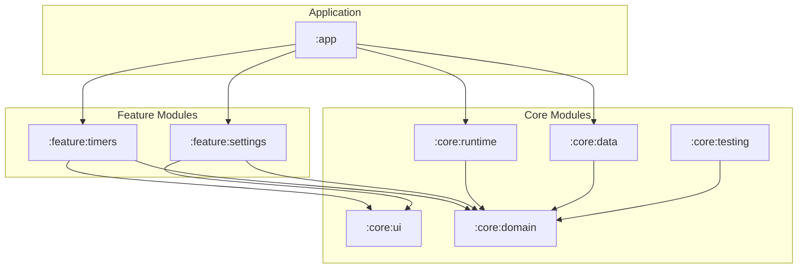

# NotificationTimer 2.0 ⏱️

Multi-timer Android app. Independent timers, custom alerts, background resilience, interactive notifications with lock-screen controls. Kotlin + Jetpack Compose multi-module architecture for Android 15+ (`minSdk 35`, `targetSdk 37`).

---

## Architecture



### Modules
- **`:app`**: Application entry point, `MainActivity`, navigation, Hilt DI.
- **`:feature:timers`**: Timer screen, horizontal pager, timer cards, island dialogs, history list with star pinning, "Keep Screen On" header toggle.
- **`:feature:settings`**: Settings UI, configurable history size, JSON backup import/export, how-it-works page.
- **`:core:ui`**: Material 3 theme, Recursive font, auto-sizing text, numpad view, keep-screen-on toggle and effect.
- **`:core:domain`**: Pure Kotlin. Models (`Timer`, `TimerConfig`, `HistoryEntry`), state machine, event scheduler, `TimerEngine`, ports (`HistoryRepository`, `DisplayPreferences`, ...). Zero Android dependencies.
- **`:core:data`**: DataStore persistence (`library.json`, `runtime.json`), normalized JSON codecs, history repository, backup repository, display preferences.
- **`:core:runtime`**: Foreground service, AlarmManager wakeup, notification renderer (`RemoteViews`), audio/vibration player.
- **`:core:testing`**: Test doubles, fake clocks, in-memory stores.

More architecture details: [docs/architecture.md](docs/architecture.md).

---

## Prerequisites
- **JDK**: 17+
- **Android SDK**: `compileSdk 37`, `minSdk 35`, `targetSdk 37`
- **Maestro CLI** (for E2E tests):
  - macOS / Linux: `curl -fsSL "https://get.maestro.mobile.dev" | bash`
  - Windows: `powershell -c "irm https://get.maestro.mobile.dev | iex"`

---

## Build
```bash
# Build debug APK
./gradlew assembleDebug
```

---

## Testing & Quality Gate

### 1. Unit & Local Tests
```bash
# All unit tests
./gradlew test

# Specific module
./gradlew :core:domain:test
./gradlew :core:runtime:testDebugUnitTest
./gradlew :core:data:testDebugUnitTest
./gradlew :feature:timers:testDebugUnitTest
```

### 2. Code Quality & Format
```bash
# Check code style & static analysis
./gradlew spotlessCheck
./gradlew detekt

# Auto-fix code formatting
./gradlew spotlessApply

# Full check
./gradlew check
```

### 3. Maestro E2E
```bash
# Install debug build
./gradlew :app:installDebug

# Run single flow
maestro test maestro/timer_basics.yaml

# Run active test suite
maestro test --exclude-tags wip maestro/
```

### 4. Quality Gate Script (Mandatory Before Commit)
- **Windows**:
  ```powershell
  .\scripts\gate.ps1
  ```
- **Linux / macOS**:
  ```bash
  ./scripts/gate.sh
  ```
Pass `-RunMaestro` (Windows) or `--maestro` (Linux/Mac) to run Maestro E2E on connected device.

More testing details: [docs/testing.md](docs/testing.md).

---

## Documentation
- [CONTRIBUTING.md](CONTRIBUTING.md): Rules for code contributions and PRs.
- [AGENT.md](AGENT.md): Strict instructions for AI agents modifying this codebase.
- [TODO.md](TODO.md): Backlog, roadmap, and completed milestones.
- [docs/architecture.md](docs/architecture.md): Module boundaries and architecture invariants.
- [docs/testing.md](docs/testing.md): Testing strategy and layers.
- [docs/spike-notifications.md](docs/spike-notifications.md): Phase 1 notification measurements and findings.
