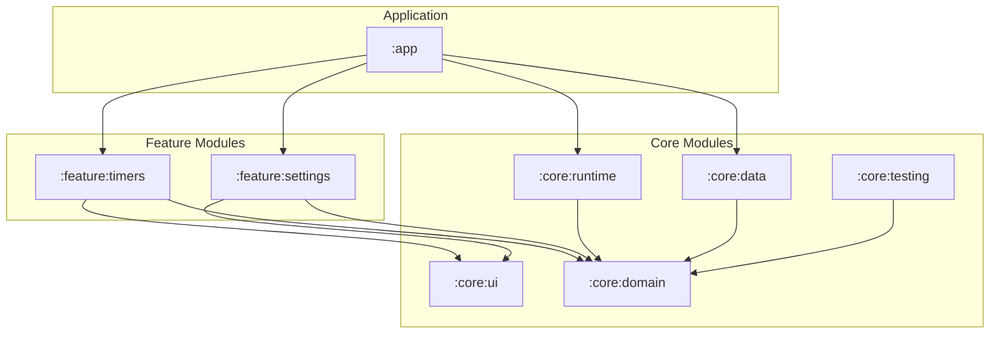

# Architecture

Lean architecture summary for NotificationTimer 2.0.

## Module Graph

## Module Responsibilities
- **`:app`**: Application setup, `MainActivity`, navigation graph, Hilt DI assembly.
- **`:feature:timers`**: Timer screen, horizontal timer pager, timer cards, island dialogs, history list with star pinning, "Keep Screen On" header toggle.
- **`:feature:settings`**: Settings screen, configurable history limit, import/export UI, how-it-works page.
- **`:core:ui`**: Material 3 theme, Recursive font, auto-sizing text, numpad view, `KeepScreenOnToggle` / `KeepScreenOnEffect`.
- **`:core:domain`**: Pure Kotlin. Models (`Timer`, `TimerConfig`, `HistoryEntry`), state machine, `TimerEngine`, event planner, ports (`TimerStore`, `HistoryRepository`, `DisplayPreferences`, ...). Zero Android dependencies.
- **`:core:data`**: DataStore persistence (`library.json`, `runtime.json`), normalized JSON codecs, history repository, backup repository, `DisplayPreferencesRepository`.
- **`:core:runtime`**: Foreground service, AlarmManager wakeup, notification renderer (`RemoteViews`), alert audio/vibration.
- **`:core:testing`**: Test doubles, fake clocks, in-memory stores.

## Invariants
- **State ownership**: Only `:core:domain` state machine modifies timer state.
- **Time source**: `TimeSource` backed by `SystemClock.elapsedRealtime()`. Never use `System.nanoTime()` or wall clock time for timer math.
- **No tick counting**: Never store ticks. Always compute remaining time from timestamps.
- **Persistence**: Save state on state change. Never save on periodic ticks. State must survive process death.
- **Single-threaded engine**: `TimerEngine` processes one command or event at a time.
- **Explicit PendingIntents**: Immutable (`FLAG_IMMUTABLE`), explicit, deterministic URI derived from `TimerId`.
- **Dumb UI**: Composables are display-only. Zero state machine logic in Compose.
- **User-owned display preferences**: "Keep Screen On" (`UserSettings.keepScreenOn` in `library.json`) only changes on explicit user tap. The app never toggles it automatically. Applied via `View.keepScreenOn` while the timers screen is visible.
- **Independent notification rendering**: Each active timer renders its notification independently on standard SystemUI notification surface (`setColorized(false)`). TimerForegroundService is an invisible process keepalive with zero visual coupling to any single timer notification.

## Dependency Rules
- Feature modules depend ONLY on `:core:domain` and `:core:ui`.
- `:core:domain` has ZERO Android dependencies.
- Only `:app` sees all modules for DI wiring.
